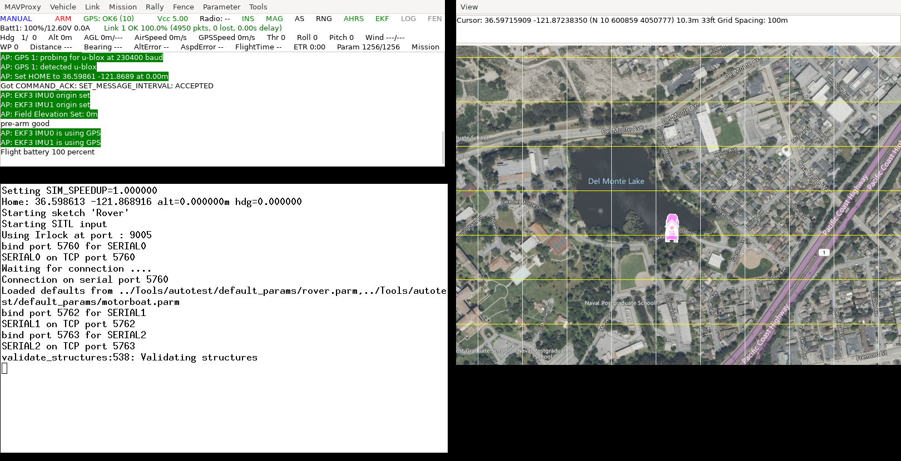
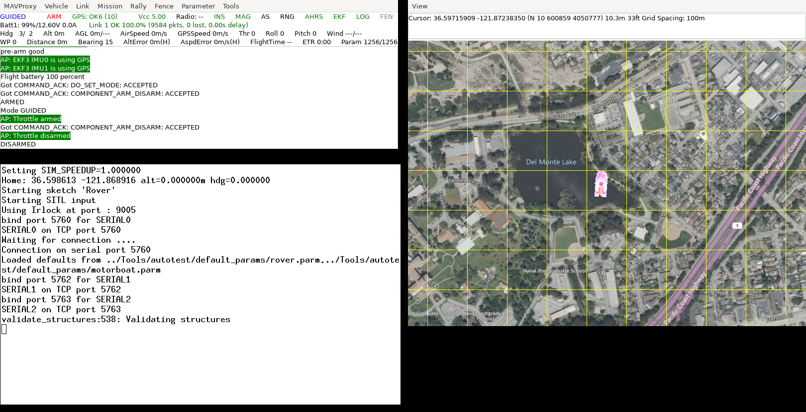
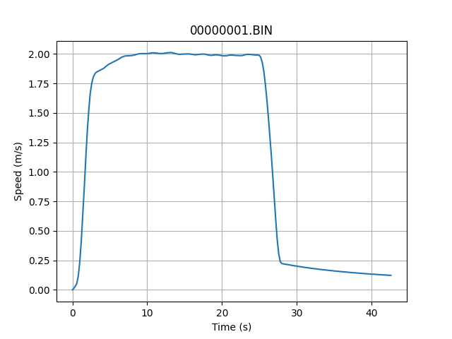

# ArduPilot Rover SITL Setup: Linux, drydock and Python
Run ArduPilot's stock motorboat in SITL (software-in-the-loop), drive it, and read its log, on Linux only: ArduPilot runs in a [drydock](https://github.com/HonuRobotics/drydock) container, so every machine starts from the same Ubuntu 22.04, and Python takes the place of MATLAB. ArduPilot is pinned to release **Rover-4.7.2**. The same functionality on Windows, with WSL2 and MATLAB, is in [SITL_Setup_for_Linux.md](SITL_Setup_for_Linux.md).

> [!NOTE]
> **Working directory.** Everything in this guide lives in one working directory, the folder the source repos are cloned into. It differs between users; this guide uses `~/WorkingCopies/usv-autopilot`. Substitute your own wherever it appears. The container uses that same folder as its home, so inside the container `~` means the working directory.

**Prerequisites**

* Linux with git, [Docker Engine](https://docs.docker.com/engine/install/ubuntu/) and Compose v2 (`docker compose version` prints a version), and a desktop session.

**Tested on**

* Ubuntu 22.04 host, Docker 29.9.3, drydock `usv-sitl` image, ArduPilot Rover-4.7.2 (commit `fb77356789`), 2026-11-20

## What runs where

| Piece | What it is | Set up by | In the working directory |
|---|---|---|---|
| usv-autopilot | this repo: the guide and the Python scripts | `git clone` on the host, Step 1 | `usv-autopilot/` |
| drydock | the container recipe; this guide uses its `usv-sitl` project | `git clone` on the host, Step 1 | `drydock/` |
| ArduPilot Rover-4.7.2 | the autopilot firmware, the motorboat physics model, and `sim_vehicle.py`, which launches both | `git clone` on the host, Step 1; built in the container, Steps 3–4 | `ardupilot/` |
| `usv-sitl` image | Ubuntu 22.04 with git, matplotlib and ArduPilot's apt dependencies | `./drydock build` on the host, Step 2 | (Docker) |
| MAVProxy, pymavlink | ground station (a command prompt plus map and console windows), and the Python MAVLink library the scripts use | ArduPilot's install script in the container, Step 3 | `.local/` (hidden) |

Git runs on the host; building and running SITL, and the Python scripts, run in the container. Commands marked *On the host* run in an ordinary terminal; commands marked *In the container* run in the shell that `./drydock run` opens. The clones are at the same paths in both. The container shares the host's network and display, so SITL's windows open on the host desktop and its UDP ports are the host's ports.


*SITL's processes and ports (from ArduPilot [1]). Ground stations connect on UDP 14550; this guide adds 14551 for the Python scripts.*

---

## Step 1. Clone the source repos

Source: ArduPilot [2], [Setting up the Build Environment (Linux/Ubuntu)](https://ardupilot.org/dev/docs/building-setup-linux.html)

On the host:

```bash
mkdir -p ~/WorkingCopies/usv-autopilot
cd ~/WorkingCopies/usv-autopilot
git clone https://github.com/Field-Robotics-Lab/usv-autopilot.git
git clone https://github.com/HonuRobotics/drydock.git
git clone --recurse-submodules --branch Rover-4.7.2 https://github.com/ArduPilot/ardupilot.git
```

`--branch Rover-4.7.2` checks out the ArduPilot release directly, with each submodule (separate projects ArduPilot includes) at the version that release was built with. The ArduPilot clone is about 2 GB and takes a few minutes.

**Check:** `ls` prints `ardupilot  drydock  usv-autopilot`; `git -C ardupilot tag --points-at HEAD` lists `Rover-4.7.2` (with the other 4.7.2 release tags, which share the commit); and `git -C ardupilot status` prints:

```
Not currently on any branch.
nothing to commit, working tree clean
```

---

## Step 2. Start the container

Source: drydock [README](https://github.com/HonuRobotics/drydock#readme)

On the host:

```bash
cd ~/WorkingCopies/usv-autopilot/drydock
./drydock build usv-sitl
./drydock run usv-sitl
```

The build takes a few minutes the first time and is cached after that. `run` starts the container and opens a shell in it, in the same folder:

```
honu@<hostname>:~/drydock$
```

The container's home is the working directory, the folder drydock is cloned into, so the prompt shows `~/drydock`. The container sees only that folder, not the rest of your home directory, so whatever later steps write under `~` stays in the working directory.

For a second shell in the same container, run `./drydock join usv-sitl` from `~/WorkingCopies/usv-autopilot/drydock`. `./drydock stop usv-sitl` removes the container; the working directory is untouched.

**Check:** in the container, `ls ~` lists `ardupilot  drydock  usv-autopilot`, and `lsb_release -ds` prints `Ubuntu 22.04.5 LTS`.

---

## Step 3. Install the build tools

Source: ArduPilot [2], [Setting up the Build Environment (Linux/Ubuntu)](https://ardupilot.org/dev/docs/building-setup-linux.html)

In the container:

```bash
cd ~/ardupilot
Tools/environment_install/install-prereqs-ubuntu.sh -y
source ~/.bashrc
```

ArduPilot's install script installs compilers and libraries with apt, and Python tools, MAVProxy and pymavlink among them, with pip into `~/.local`. The image already has every apt package, so only the pip part does any work; it takes a few minutes. The script detects the container and writes its PATH settings to `~/.ardupilot_env`, which `~/.bashrc` loads; `source ~/.bashrc` applies them to this shell. These hidden files are in the working directory, not in your own home.

You should see, among a lot of pip output:

```
0 upgraded, 0 newly installed, 0 to remove and 0 not upgraded.
...
Inside docker, we add the tools path into .bashrc directly
...
---------- Tools/environment_install/install-prereqs-ubuntu.sh end ----------
```

`0 newly installed` is the apt step finding everything already in the image.

**Check:** `which sim_vehicle.py mavproxy.py` prints two paths, ending in `ardupilot/Tools/autotest/sim_vehicle.py` and `.local/bin/mavproxy.py`.

---

## Step 4. Build SITL

Source: ArduPilot [3], [Building ArduPilot (BUILD.md, Rover-4.7.2)](https://github.com/ArduPilot/ardupilot/blob/Rover-4.7.2/BUILD.md)

In the container, in `~/ardupilot`:

```bash
./waf configure --board sitl
./waf rover
```

`waf` is ArduPilot's build tool. This builds the Rover firmware, which ArduPilot uses for both ground rovers and boats, as one program for this computer: `build/sitl/bin/ardurover`, the same autopilot that runs on a flight controller. It takes a minute or two.

**Check:** the build ends with:

```
'rover' finished successfully (1m28.837s)
```

---

## Step 5. Launch the motorboat at the test lake

Source: ArduPilot [4], [SITL Simulator (Software in the Loop)](https://ardupilot.org/dev/docs/sitl-simulator-software-in-the-loop.html); [5], [Using SITL](https://ardupilot.org/dev/docs/using-sitl-for-ardupilot-testing.html)

In the container:

```bash
mkdir -p ~/.config/ardupilot
grep -q "^LAKE=" ~/.config/ardupilot/locations.txt 2>/dev/null || \
  echo "LAKE=36.5986135,-121.8689162,0,0" >> ~/.config/ardupilot/locations.txt
cd ~/ardupilot/Rover
../Tools/autotest/sim_vehicle.py -f motorboat --map --console -L LAKE --out=udp:127.0.0.1:14551
```

The first three lines save the test lake as a named location, `LAKE` (latitude, longitude, altitude, heading), once. `sim_vehicle.py` runs from the `Rover` folder, which is how it picks the Rover firmware. `-f motorboat` picks ArduPilot's stock motorboat physics, `--map --console` opens MAVProxy's windows, and `--out` adds a second MAVLink output on UDP port 14551 for the Python scripts (port 14550 is the default, for ground stations).

Within a minute three windows open on the host desktop, and the terminal shows the MAVProxy prompt, `MANUAL>`:



*Top left, the MAVProxy console: mode `MANUAL`, `ARM` in red (disarmed), `GPS: OK6`, `Link 1 OK`, and the start-up messages ending in `EKF3 IMU0 is using GPS`. Bottom left, the `Rover` terminal, which runs the autopilot itself (`ardurover`) and ends at `Validating structures`. Right, the map, with the boat on the south shore of Del Monte Lake.*

**Check:** the console has printed, among others:

```
AP: Set HOME to 36.59861 -121.8689 at 0.00m
pre-arm good
AP: EKF3 IMU0 is using GPS
```

`EKF3 IMU0 is using GPS` means the simulated GPS and the navigation filter are ready; the boat cannot be driven before it.

Leave SITL running for the next steps. Optionally, a ground station on the host connects on **UDP 14550**; on Linux, [QGroundControl](https://docs.qgroundcontrol.com/master/en/qgc-user-guide/getting_started/download_and_install.html) (an AppImage) connects there by itself.

---

## Step 6. Check the connection

Source: ArduPilot [6], [Using pymavlink](https://ardupilot.org/dev/docs/mavlink-use-mavlink-with-pymavlink.html)

In a second container shell (`./drydock join usv-sitl` from `~/WorkingCopies/usv-autopilot/drydock` on the host), with SITL running:

```bash
python3 ~/usv-autopilot/usv-sitl/python/check_sitl_link.py
```

[check_sitl_link.py](../../python/check_sitl_link.py) listens on UDP port 14551 for 3 seconds and prints the most recent HEARTBEAT message from the autopilot, the message every MAVLink vehicle sends once a second.

**Check:** the script prints

```
HEARTBEAT from SystemID 1, ComponentID 1: SURFACE_BOAT, mode MANUAL, disarmed
Python is receiving messages from SITL.
```

---

## Step 7. Drive the boat and record a log

Source: ArduPilot [5], [Using SITL](https://ardupilot.org/dev/docs/using-sitl-for-ardupilot-testing.html)

In the second container shell:

```bash
python3 ~/usv-autopilot/usv-sitl/python/drive_sitl_run.py
```

[drive_sitl_run.py](../../python/drive_sitl_run.py) makes one straight run: it sets `WP_SPEED` to 2 m/s (the speed in Guided and Auto modes; the motorboat's default is 5), switches to Guided mode, arms, sends the boat 50 m north, waits until it stops there, and disarms. Arming starts the motor and a new log; disarming closes it. The same run by hand is `param set WP_SPEED 2`, `mode guided` and `arm throttle` at the `MANUAL>` prompt, then right-click on the map and **Fly To**, then `disarm`.

**Check:** the script prints

```
Start 36.598613 -121.868916; target 50 m north at 2.0 m/s
Armed: log started
Arrived after 28 s, top speed 1.98 m/s, 0.5 m from the target
Disarmed: log closed
```

and the boat has moved onto the lake:



*After the run: the boat about 50 m north of its start, out on the lake. The console shows the sequence `Mode GUIDED`, `ARMED`, `AP: Throttle armed`, `AP: Throttle disarmed`, `DISARMED`.*

On the host, the log is in the ArduPilot clone:

```bash
ls -l ~/WorkingCopies/usv-autopilot/ardupilot/Rover/logs
```

```
-rw-r--r-- 1 <you> <you> 2938204 Nov 20 12:43 00000001.BIN
-rw-r--r-- 1 <you> <you>       3 Nov 20 12:42 LASTLOG.TXT
```

Each arm-disarm cycle adds one numbered `.BIN` file.

---

## Step 8. Read the log

Source: ArduPilot [7], [Downloading and Analyzing Data Logs](https://ardupilot.org/rover/docs/common-downloading-and-analyzing-data-logs-in-mission-planner.html)

In the second container shell:

```bash
python3 ~/usv-autopilot/usv-sitl/python/read_sitl_run.py
```

[read_sitl_run.py](../../python/read_sitl_run.py) finds the newest `.BIN` log in `~/ardupilot/Rover/logs`, plots GPS ground speed against time in a window and as a `.png` next to the log, and writes the parameters recorded in the log to a `.parm` file next to it, one `NAME,VALUE` per line.

matplotlib may first warn `Unable to import Axes3D`; it is harmless here (MAVProxy's pip install brings a second matplotlib alongside the image's).

**Check:** the script prints

```
Reading /home/<you>/WorkingCopies/usv-autopilot/ardupilot/Rover/logs/00000001.BIN
Wrote 1256 parameters to .../00000001.parm
Saved the plot to .../00000001.png; top speed 2.01 m/s
```

and the plot shows the speed rising to 2 m/s, holding, and dropping when the boat reaches the point:



*Ground speed from the log. The slow tail after about 28 s is the boat coasting after the motor stops, slowed only by drag.*

`grep WP_SPEED ~/ardupilot/Rover/logs/00000001.parm` prints `WP_SPEED,2`.

---

## Troubleshooting

**`no such project 'usv-sitl'`** from `./drydock` — the drydock clone predates the `usv-sitl` project. `git pull` in `~/WorkingCopies/usv-autopilot/drydock`.

**`ls ~` in the container does not show `ardupilot`** — drydock is not cloned into the working directory. The container's home is whatever folder holds the `drydock` clone; clone all three repos side by side, as in Step 1.

**`Authorization required, but no authorization protocol specified`**, or no windows open — the container cannot reach the host's display. Run SITL from a shell started with `./drydock run` or `./drydock join`, which pass the display through; see the drydock README.

**`git status` shows `modules/picolibc/` as untracked** — ArduPilot was cloned without `--branch Rover-4.7.2` and checked out afterwards. Harmless, but the check in Step 1 then fails; clone again as written.

**`sim_vehicle.py: command not found`** — the shell has not loaded the install script's PATH settings. `source ~/.bashrc`, or open a new container shell.

**`sim_vehicle.py` stops at `Run MavProxy` with `No such file or directory: 'mavproxy.py'`** — Step 3's pip install did not finish, or `~/.local/bin` is not on PATH. Rerun the install script; if `which mavproxy.py` still prints nothing while `ls ~/.local/bin/mavproxy.py` finds it, the image is older than this guide: `./drydock build usv-sitl` again.

**`geocoder access denied (HTTP 403) for 'LAKE'`**, and SITL exits — `LAKE` is not in `~/.config/ardupilot/locations.txt`, so `sim_vehicle.py` tried to look the name up online. Run the first three lines of Step 5.

**`bind failed on port 5760 - Address already in use`** in the `Rover` window, the console stuck at `link 1 down`, and the map in Canberra, Australia — another SITL is already running on this machine, in this container or any other (containers share the host's network). Stop it first.

**`arm throttle` is refused, or `drive_sitl_run.py` says there is no position yet** — the console has not yet printed `EKF3 IMU0 is using GPS`. Wait for it.

**A script prints `No HEARTBEAT`** — SITL was launched without `--out=udp:127.0.0.1:14551`. At the `MANUAL>` prompt, `output add 127.0.0.1:14551` adds it without restarting; `output` lists both 14550 and 14551. Only one script can listen on 14551 at a time.

**`read_sitl_run.py` says `No .BIN logs`** — no run has been armed and disarmed yet, or `usv-autopilot` and `ardupilot` are not side by side in the working directory; the script looks in `../../../ardupilot/Rover/logs` from its own folder.

---

## References

1. ArduPilot, [SITL Simulator: architecture](https://ardupilot.org/dev/docs/sitl-simulator-software-in-the-loop.html)
2. ArduPilot, [Setting up the Build Environment (Linux/Ubuntu)](https://ardupilot.org/dev/docs/building-setup-linux.html)
3. ArduPilot, [Building ArduPilot (BUILD.md, Rover-4.7.2)](https://github.com/ArduPilot/ardupilot/blob/Rover-4.7.2/BUILD.md)
4. ArduPilot, [SITL Simulator (Software in the Loop)](https://ardupilot.org/dev/docs/sitl-simulator-software-in-the-loop.html)
5. ArduPilot, [Using SITL](https://ardupilot.org/dev/docs/using-sitl-for-ardupilot-testing.html)
6. ArduPilot, [Using pymavlink](https://ardupilot.org/dev/docs/mavlink-use-mavlink-with-pymavlink.html)
7. ArduPilot, [Downloading and Analyzing Data Logs](https://ardupilot.org/rover/docs/common-downloading-and-analyzing-data-logs-in-mission-planner.html)
